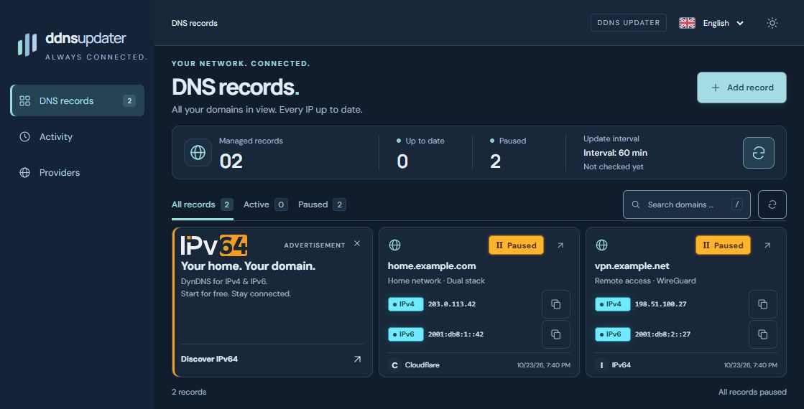

# DDNS Updater · reactor2k3

A self-hosted Dynamic DNS updater with a compact, responsive web interface.
Manage DNS records and keep IPv4 and IPv6 addresses in sync — from your desktop
or phone. Sign in with a password over local-network HTTP, or use passkeys over
HTTPS with a trusted certificate.

Built with Go. Distributed as a Docker image. Based on
[qdm12/ddns-updater](https://github.com/qdm12/ddns-updater) by Quentin McGaw.



*English interface with fictional, paused records and documentation-only IP addresses.*

Review the deployment settings and keep backups before using the application
for important services.

## What is included

- **59 provider configurations**, including Cloudflare, DuckDNS, Hetzner, IONOS
  and IPv64. Searchable provider selector, floating labels, examples and contextual help.
- Create, edit, pause and remove records in the browser. Dual-stack records show
  IPv4 and IPv6 together, with clear status labels and copy buttons.
- Automatic checks, manual refresh and separate public IP discovery. Provider
  cooldowns remain enforced; viewing the dashboard never sends update requests.
- One administrator account, first-run setup, password login and WebAuthn passkeys.
  Five failed password attempts trigger a 15-minute lockout. Optional persistent
  sessions, named trusted devices and session revocation.
- Download and restore backups in the browser. Restoring pauses every DNS entry
  and signs out existing sessions. A safety backup is created before replacement.
- English and German, system-selected language, light and dark themes, mobile
  layouts and installable web-app assets.
- Original provider integrations, environment settings, notifications and health checks.

## Quick start with Docker Compose

The default [docker-compose.yml](docker-compose.yml) uses the published
`ghcr.io/reactor2k3/ddns-updater:latest` image and **host networking**. It has
no Compose `version` field, no fixed image version and no port mapping. Images
support Linux AMD64 and ARM64. Docker Hub publication is not enabled.

1. Download [docker-compose.yml](docker-compose.yml) and [.env.example](.env.example)
   into the same directory. Rename `.env.example` to `.env`.
2. Set `WEB_HOST` to **your Docker host's private LAN IP** and choose a free port:

   ```dotenv
   WEB_HOST=192.168.1.100
   WEB_PORT=8095
   ```

   `192.168.1.100` is an example; replace it with your own server's address.
3. Start the container and read the initial setup key:

   ```sh
   docker compose up -d
   docker compose logs ddns-updater
   ```

Open `http://YOUR_SERVER_IP:8095` from any computer on your LAN. Enter the initial
setup key from the logs to create the single administrator account. No preset
account, provider key or DNS record is included. Keep the persistent `ddns-data`
volume when updating or recreating the container.

The server listens on `0.0.0.0:8095` by default in this example. To use another
port, change `WEB_PORT`; both the listener and default browser origin follow it.
Host networking is supported on Linux Docker Engine and Docker Desktop 4.34+
when explicitly enabled in Desktop settings. [Docker documentation](https://docs.docker.com/engine/network/drivers/host/).

### HTTP and HTTPS

| Access | Sign-in | Requirement |
| --- | --- | --- |
| Private LAN HTTP (default) | Password | Private-IP browser origin and private/loopback client IP |
| HTTPS through a reverse proxy | Password and passkeys | Exact HTTPS origin; passkeys require a trusted certificate and suitable hostname |

HTTP transmits passwords, sessions and provider credentials without encryption.
The login and account pages show a warning; passkey actions are disabled in LAN
HTTP mode. Public-IP and hostname-based HTTP origins are rejected. Do not expose
the HTTP listener directly to the internet.

For HTTPS, configure your reverse proxy to forward to the updater's HTTP port
and preserve the original Host header. Add its exact browser-facing address to
`.env`, for example:

```dotenv
AUTH_ORIGIN=https://ddns.example.com
```

Recreate the container after changing its environment. Passkeys become available
automatically for the HTTPS origin. A certificate-warning override may still
leave passkeys unavailable. Localhost remains the development exception. Keep
the same hostname when registering and using passkeys. To require HTTPS outside
localhost, also set `AUTH_ALLOW_INSECURE_HTTP=false`.

The container runs as UID/GID 1000. The data volume and backup ZIPs contain
authentication data and provider credentials; store them securely. Backups are
not encrypted.

### Updates

```sh
docker compose pull
docker compose up -d
```

[compose.host.yaml](compose.host.yaml) provides the same configuration for users
who prefer that filename; use `docker compose -f compose.host.yaml ...` with it.

## Build from source

```sh
git clone https://github.com/reactor2k3/ddns-updater.git
cd ddns-updater
docker compose -f compose.build.yaml up -d --build
docker compose -f compose.build.yaml logs ddns-updater
```

The complete application lives at the repository root. There is no separate
frontend build or Node runtime in the production image. Go embeds the web assets.
For native development, use Go 1.26.10 or newer:

```sh
go test ./...
go vet ./...
go build -o ddns-updater ./cmd/ddns-updater
```

After changing provider form definitions, run `node scripts/sync-ui.cjs` to
regenerate the server-side catalog. Node is only needed for this development step.

## Configuration and documentation

| Setting | Purpose | Default |
| --- | --- | --- |
| `AUTH_ORIGIN` | Exact externally visible origin for authentication | `http://localhost:8000` |
| `AUTH_ALLOW_INSECURE_HTTP` | Permit password login over HTTP on private LAN IPs; passkeys disabled | `true` |
| `DATADIR` | Persistent data directory | `/updater/data` in Docker |
| `PERIOD` | Public IP and DNS check interval | `5m` |
| `UPDATE_COOLDOWN_PERIOD` | Minimum time between provider updates | `5m` |
| `PUBLICIP_HTTP_PROVIDERS` | HTTP providers used for automatic IP selection | `all` |
| `PUBLICIPV4_HTTP_PROVIDERS` / `PUBLICIPV6_HTTP_PROVIDERS` | Separate family-specific providers | `all` |
| `BACKUP_PERIOD` | Scheduled on-disk backups; browser downloads are separate | `0` (disabled) |
| `CONFIG` | Environment-managed provider configuration; makes web editing read-only | unset |

- [Web management, security and persistence](docs/web-management.md)
- [Installation and configuration](docs/install.md)
- [Provider documentation](docs/)
- [Notifications with Shoutrrr](https://containrrr.dev/shoutrrr/v0.8/services/overview/)
- [Asset attribution](docs/assets.md)

## Releases

GitHub Actions runs the Go race tests, static analysis, reachable-vulnerability
checks and a container smoke test before publishing a release image. Release
images support `linux/amd64` and `linux/arm64`. Pin a version rather than
relying on a moving tag. Pre-releases do not update `latest`.

## Credits and license

The updater and original provider implementations were created by
[Quentin McGaw (qdm12)](https://github.com/qdm12) in
[qdm12/ddns-updater](https://github.com/qdm12/ddns-updater).

This independent fork is maintained by [reactor2k3](https://github.com/reactor2k3).
The redesigned interface, web record management, authentication and backup features
were developed with assistance from ChatGPT/Codex. This is not an official qdm12 release.

The project is distributed under the [MIT license](LICENSE). Original copyright
and license notices are preserved. Third-party brand assets belong to their owners.
